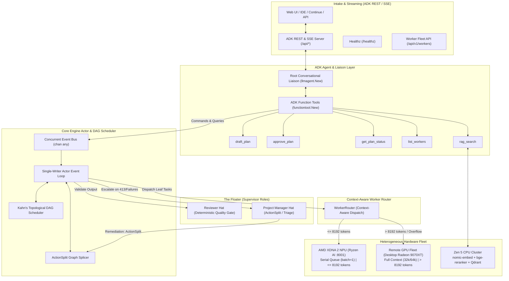

# Go Orchestrator (ADK v2 & Strix Halo Heterogeneous Stack)

An event-driven, heterogeneous AI agent orchestration engine written in Go. Built with **Google ADK Go (`google.golang.org/adk/v2`)**, it coordinates multi-tier reasoning models, hierarchical DAG workflow scheduling, and intelligent hardware dispatching across **AMD Strix Halo APUs (Ryzen AI NPU + Zen 5 CPU cluster + RDNA 3.5 GPU)** and remote GPU fleets.

---

## Architecture at a Glance



---

## Key Pillars

### 1. Powered by Google ADK Go (`v2`)
* **Conversational Liaison**: Root reasoning loop implemented using `llmagent.New(...)` backed by `openaimodel.NewModel` connecting to Gemma 4 26B on vLLM.
* **REST & SSE Server**: Out-of-the-box streaming and session management via `adkrest.NewServer` mounted at `/api/`.
* **Zero Boilerplate**: Eliminated ~2,600 lines of custom Swagger generators, hand-rolled HTTP multiplexers, and bespoke JSON-RPC layers.

### 2. Heterogeneous AMD Hardware Execution
* **AMD XDNA 2 NPU Worker (`onnx_goworker` on `:8001`)**:
  * Pinned to a single OS thread via `runtime.LockOSThread()`.
  * Serial queue (`batch = 1`) with hardware warmup on startup.
  * Hard 8,192 token context limit check with fast-fail `HTTP 413 Payload Too Large`.
  * Preserved `/v1/completions` for instant tab autocomplete in VS Code Continue.
* **Context-Aware Worker Router**:
  * $\le$ 8,192 tokens $\rightarrow$ routed to local energy-efficient NPU.
  * \> 8,192 tokens $\rightarrow$ routed to desktop Radeon RX 9070XT GPU worker.
  * **Auto-Splitting on GPU Offline**: If remote GPU is offline or NPU returns HTTP 413, the task is immediately escalated to the Project Manager Hat (`ActionSplit`) to be spliced into smaller sub-tasks that fit the local 8k window.

### 3. Core Engine & Kahn's Topological DAG Scheduler
* **Single-Writer Actor State Machine**: All mutable workflow state is owned by a single actor goroutine over `chan any`.
* **Dynamic Graph Splicing**: Tasks that fail or exceed context limits are split into sub-tasks. The parent task becomes a join node in Kahn's DAG, preserving downstream dependencies.
* **Strict Quality Gates**: The Reviewer Hat deterministically evaluates outputs against verifiable acceptance criteria before permitting downstream tasks to execute.

### 4. Zen 5 Local RAG Cluster
* **Dense Embedding**: `llama-embed` running `nomic-embed-text-v1.5.Q8_0` with AVX-512 acceleration.
* **Cross-Encoder Reranker**: `llama-rerank` running `bge-reranker-large-Q8_0`.
* **Vector Store**: High-performance local Qdrant instance.

---

## Quickstart

### Prerequisites
- Go 1.24+ (or Go 1.26+)
- Docker & Docker Compose with AMD ROCm / Ryzen AI support

### Running Locally

```bash
# Clone and build static binary
cd orchestrator
go build -o /tmp/orchestrator .

# Run with full stack endpoints
/tmp/orchestrator \
  -port 8080 \
  -lrm-url http://localhost:8000 \
  -worker-url http://localhost:8001 \
  -embed-url http://localhost:8082 \
  -rerank-url http://localhost:8083 \
  -qdrant-url http://localhost:6333
```

### Running with Docker Compose

From the root of `local_ai_stack`:

```bash
# Build and ignite the orchestrator container
docker compose up -d --build orchestrator
```

### Running Tests

```bash
# Run all unit tests across engine, agent, tasks, and rag
go test -count=1 ./...
```

---

## ADK Tools & Endpoints

### ADK Tools (Function Calling)

| Tool | Parameters | Description |
| :--- | :--- | :--- |
| `draft_plan` | `title`, `objective`, `epics` | Validates acyclic DAG plan and registers it as a draft awaiting user approval. |
| `approve_plan` | `plan_id` | Approves a validated draft and launches execution across the NPU/GPU fleet. |
| `get_plan_status` | `plan_id` | Inspects real-time execution status, leaf tasks, retries, and generated artifacts. |
| `list_workers` | *(none)* | Queries registered hardware workers, context ceilings, and telemetry. |
| `rag_search` | `query`, `collection`, `top_k` | Runs vector search with cross-encoder reranking over local documentation and code. |

### REST Endpoints

| Endpoint | Method | Description |
| :--- | :--- | :--- |
| `/api/*` | `GET`, `POST` | ADK REST & SSE Streaming protocol for client applications. |
| `/api/v1/workers` | `GET` | Returns list of registered worker nodes and their active status. |
| `/api/v1/workers` | `POST` | Registers a new remote GPU worker (e.g. desktop 9070XT) into the router. |
| `/healthz` | `GET` | Health check (`{"status":"ok","framework":"google-adk-v2"}`). |

---

## Project Structure

```
orchestrator/
├── main.go                     # Entrypoint: ADK REST server, WorkerRouter, Kahn engine
├── agent/
│   ├── chat.go                 # Root Conversational Liaison Agent (llmagent.New)
│   └── tools.go                # ADK Function Tools (draft_plan, approve_plan, rag_search, etc.)
├── engine/
│   ├── dag.go                  # Kahn's topological scheduler & cycle validator
│   ├── orchestrator.go         # Actor event loop, task execution, and Reviewer/PM escalation
│   ├── worker_router.go        # Context-aware worker dispatch (NPU vs. 9070XT)
│   └── types.go                # Plan, Task, and Actor Event definitions
├── llm/
│   ├── client.go               # LLMClient interface & transport abstraction
│   ├── lrm.go                  # Multi-hat persona engine (Reviewer & PM hats)
│   ├── schema.go               # Structured plan, review, and remediation schemas
│   └── mock.go                 # Deterministic offline mock for millisecond unit tests
├── rag/
│   └── client.go               # Zen 5 Embedding, Reranking, and Qdrant vector client
├── tasks/
│   ├── registry.go             # TaskHandler interface & thread-safe registry
│   ├── codegen.go              # Leaf code generator handler
│   ├── extract.go              # Leaf text extraction handler
│   └── rag.go                  # Ingestion & search task handlers
└── builder/
    └── Dockerfile              # Multi-stage static FROM scratch container (~13MB)
```

---

## License

This project is licensed under the terms of the [MIT License](LICENSE).
