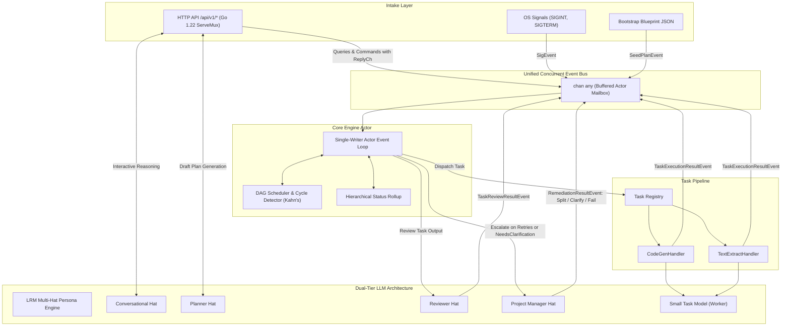

# Go Orchestrator

An event-driven agentic orchestration engine written in Go (Go 1.22+). It separates **high-level strategic reasoning** (handled by a Large Reasoning Model wearing multiple cognitive "hats") from **low-level task execution** (handled by fast worker models) over a unified, non-blocking concurrent event bus (`chan any`).

The system avoids shared-memory mutex contention across the core engine by implementing a **single-writer actor event loop** that serves as the sole owner of mutable plan, task, and DAG state.

---

## Architecture at a Glance



---

## Key Features

1. **Dual-Tier Cognitive Model:**
   - **Large Reasoning Model (LRM):** A single LLM wrapped in strongly-typed system-prompt profiles:
     - **Conversational Hat:** Operates over live system state snapshots, explains blockers, and classifies user chat into draft plans.
     - **Planner Hat:** Decomposes user directives into hierarchical plans (**Epics $\rightarrow$ Stories $\rightarrow$ Tasks**) forming a verifiable DAG.
     - **Reviewer Hat:** Validates completed worker outputs against objective acceptance criteria (`Approved`, `Feedback`, `NeedsClarification`, `Score`).
     - **Project Manager Hat:** Triages failing tasks, executing dynamic DAG re-decomposition (`split`) or pausing branches for user input (`clarify`).
   - **Small Task Model (Worker):** Executes atomic leaf tasks using only targeted local context (task spec, direct upstream dependency outputs, and reviewer feedback).

2. **Single-Writer Actor State Machine:**
   - All mutable state lives inside the event loop goroutine.
   - External callers (HTTP requests, worker goroutines) communicate strictly by sending event structs over `eventCh chan any`. Synchronous HTTP handlers embed a buffered `replyCh` to receive responses without locks.

3. **Kahn's Algorithm DAG Scheduler:**
   - Go-side structural validation verifies dependency integrity, handler registration, and cycle-free topological order before any plan or spliced sub-graph executes.

4. **Self-Healing Remediation & Clarification Loop:**
   - **Tactical Retry:** Failed worker tasks append reviewer feedback and retry up to `MaxRetries` (default: 3).
   - **Dynamic DAG Splicing (`ActionSplit`):** Tasks too complex for a small model are decomposed into sub-tasks. The original task becomes a join node waiting on terminal sub-tasks, preserving downstream dependencies.
   - **Targeted Clarification (`ActionClarify`):** Ambiguous tasks pause in `StatusAwaitingClarification`. Transitive dependents transition to `StatusBlocked`, while independent DAG branches continue executing concurrently.
   - **Resumption:** User clarifications submitted via the API resume the paused branch without discarding upstream work.

5. **Production Deployment Options:**
   - Host binary compilation, static linking, and ultra-minimal `FROM scratch` containerization (~13MB, zero CVE surface, non-root UID `10001`, no CA cert overhead needed for Cloudflare Tunnel setups).

---

## Quickstart

### Prerequisites
- Go 1.22+ (tested with Go 1.22+)
- Make (optional, for build shortcuts)
- Docker (optional, for container builds)

### 1. Build and Run on Host

```bash
# Build binary into ./build/orchestrator
make build

# Run in offline mock mode (runs immediately without local model servers or API keys)
./build/orchestrator -blueprint example_blueprint.json -port 8080
```

### 2. Run Tests

```bash
# Run all unit and integration tests across all packages
make test

# Run tests with coverage profile
make test-coverage
```

### 3. Connect to Real LLM Endpoints

`GoOrchestrator` speaks the standard OpenAI-compatible `/v1/chat/completions` API (vLLM, Ollama, llama.cpp, LocalAI, TGI, or cloud providers):

```bash
./build/orchestrator \
  -mode http \
  -lrm-url http://localhost:8000 \
  -worker-url http://localhost:8001 \
  -port 8080
```

---

## API Summary

The HTTP API uses Go 1.22 method+path routing:

| Endpoint | Method | Description |
| :--- | :--- | :--- |
| `/api/v1/chat` | `POST` | Conversational intake, live status queries, and automatic DAG plan drafting. |
| `/api/v1/plans` | `GET` | Lists all execution plans and their statuses. |
| `/api/v1/plans/{planID}` | `GET` | Returns real-time hierarchical plan tree, outputs, and pending questions. |
| `/api/v1/plans/{planID}/approve` | `POST` | Approves a draft plan or injects a raw JSON plan spec. |
| `/api/v1/plans/{planID}/tasks/{taskID}/clarify` | `POST` | Submits user clarification for a paused task, unblocking dependents. |
| `/openapi.yaml` | `GET` | Serves the embedded OpenAPI 3.1 specification. |
| `/healthz` | `GET` | Health check endpoint (`{"status": "ok"}`). |

---

## Project Structure

```
GoOrchestrator/
├── Makefile                          # Build, static linking, test, and container targets
├── .gitignore                        # Ignores build artifacts, coverage files, and binaries
├── example_blueprint.json            # Example bootstrap plan (Epics -> Stories -> Tasks)
├── builder/
│   ├── Dockerfile                    # Minimalist multi-stage FROM scratch container (~13MB)
│   └── example_docker_compose.yaml   # Stack with orchestrator, Cloudflare tunnel & local vLLM
├── docs/
│   ├── overview.md                   # System architecture and end-to-end design
│   ├── build.md                      # Compilation, static linking, and container deployment
│   ├── engine.md                     # Actor event loop, Kahn's DAG algorithm, and remediation
│   ├── llm.md                        # Dual-tier model architecture, multi-hat engine, and mock
│   ├── tasks.md                      # TaskHandler interface, CodeGen, and TextExtract pipelines
│   └── api.md                        # Go 1.22 ServeMux REST API and OpenAPI 3.1
├── api/                              # REST API and reply-channel bridge
├── engine/                           # Actor event loop and DAG scheduler
├── llm/                              # Model access layer and multi-hat persona engine
└── tasks/                            # Domain-agnostic task execution pipeline
```

---

## Documentation

Detailed documentation is available in the [`docs/`](./docs) directory:
- [System Architecture & Overview](docs/overview.md)
- [Build, Packaging & Docker Deployment](docs/build.md)
- [Engine Actor & DAG Scheduler](docs/engine.md)
- [Dual-Tier LLM Architecture](docs/llm.md)
- [Task Pipeline & Handlers](docs/tasks.md)
- [Conversational API & Specifications](docs/api.md)
- [Swagger 2.0 API Spec (YAML)](docs/swagger.yaml)
- [Swagger 2.0 API Spec (JSON)](docs/swagger.json)

---

## Acknowledgments

This project was built collaboratively by:
- **Lead Architect & Developer:** [bluefalcon13](https://github.com/bluefalcon13)
- **AI Collaborators:** Antigravity (Google DeepMind) & Claude Opus (Anthropic)

---

## License

This project is licensed under the terms of the [MIT License](LICENSE).


