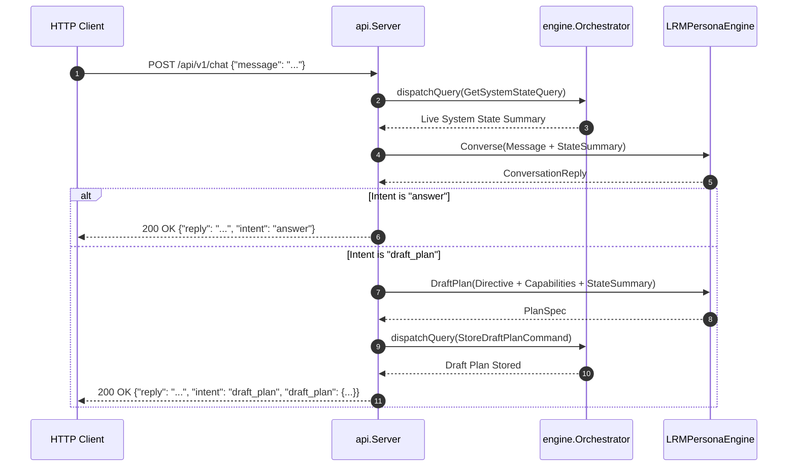

# Module Reference: `api` (Conversational API & OpenAPI)

The `api` package exposes the HTTP interface for interactive orchestration, plan approval, real-time monitoring, and clarification submission. It leverages Go 1.22+ method and path pattern routing and bridges synchronous HTTP requests to the engine actor event loop.

---

## 1. Go 1.22+ HTTP Routing

The API uses `net/http.NewServeMux` with native method and path parameter routing:

| Method & Pattern | Handler | Purpose |
| :--- | :--- | :--- |
| `POST /api/v1/chat` | `handleChat` | Conversational intake, live status queries, and automatic DAG plan drafting. |
| `GET /api/v1/plans` | `handleListPlans` | Lists all execution plans and their current statuses. |
| `GET /api/v1/plans/{planID}` | `handleGetPlan` | Returns real-time hierarchical status, outputs, and clarification questions for a plan. |
| `POST /api/v1/plans/{planID}/approve` | `handleApprovePlan` | Approves a draft plan or injects a raw plan JSON into active execution. |
| `POST /api/v1/plans/{planID}/tasks/{taskID}/clarify` | `handleClarifyTask` | Submits a user answer for a paused task, unblocking downstream dependencies. |
| `GET /openapi.yaml` | `handleOpenAPI` | Serves the embedded OpenAPI 3.1 YAML specification. |
| `GET /healthz` | Inline | Health check endpoint returning `{"status": "ok"}`. |

---

## 2. Synchronous-to-Asynchronous Bridging

HTTP handlers must return synchronous responses, whereas the engine state machine operates asynchronously over `eventCh chan any`.

To bridge this boundary cleanly without shared locks, the API employs the generic [`dispatchQuery`](file:///home/jfisher/projects/GoOrchestrator/api/server.go#L299) pattern:

```go
func dispatchQuery[T any](ctx context.Context, ch chan any, buildMsg func(chan T) any) (T, error) {
    replyCh := make(chan T, 1) // Buffered to prevent leaking goroutines on client abort
    msg := buildMsg(replyCh)

    // 1. Enqueue query/command to actor event loop
    select {
    case ch <- msg:
    case <-ctx.Done():
        var zero T
        return zero, ctx.Err()
    }

    // 2. Await synchronous response from actor event loop
    select {
    case res := <-replyCh:
        return res, nil
    case <-ctx.Done():
        var zero T
        return zero, ctx.Err()
    }
}
```

This guarantees:
1. **Safety Under Cancellation:** If a client cancels the request (e.g. timeout or disconnect), `ctx.Done()` fires without hanging the handler.
2. **Leak-Free Channels:** The reply channel has a capacity of 1, allowing the engine to write its response safely even if the HTTP handler has already returned.
3. **Strict State Isolation:** The HTTP handler never accesses or mutates the internal plan structures directly.

---

## 3. Conversational Intake Flow (`/api/v1/chat`)

The chat endpoint combines the Conversational Hat and the Planner Hat into a seamless workflow:



---

## 4. Clarification Resolution (`/api/v1/plans/{planID}/tasks/{taskID}/clarify`)

When a task enters `StatusAwaitingClarification`, the user provides answers through this endpoint:
1. Verifies that the task exists and is currently in `StatusAwaitingClarification`.
2. Invokes `lrm.InterpretClarification()` (Conversational Hat) with the paused task's explanation, pending question, and user answer to create an updated, self-contained task description and any new acceptance criteria.
3. Dispatches [`ClarificationResolvedEvent`](file:///home/jfisher/projects/GoOrchestrator/engine/types.go#L131) to the engine event loop.
4. The engine updates the task, resets attempt counters, unblocks downstream tasks from `StatusBlocked` back to `StatusPending`, and re-triggers DAG execution.

---

## 5. API Specifications (OpenAPI 3.1 & Swagger 2.0)

The orchestrator documentation includes both modern OpenAPI 3.1 and classic Swagger 2.0 specifications:

1. **OpenAPI 3.1 Specification:**
   - Embedded directly in the binary ([`api/openapi.go`](file:///home/jfisher/projects/GoOrchestrator/api/openapi.go)) and served live at `GET /openapi.yaml`.
2. **Swagger 2.0 Specification:**
   - Maintained in [`docs/swagger.yaml`](file:///home/jfisher/projects/GoOrchestrator/docs/swagger.yaml) and [`docs/swagger.json`](file:///home/jfisher/projects/GoOrchestrator/docs/swagger.json) for compatibility with legacy Swagger UI, Swagger Editor, Postman, and code generation tools.


