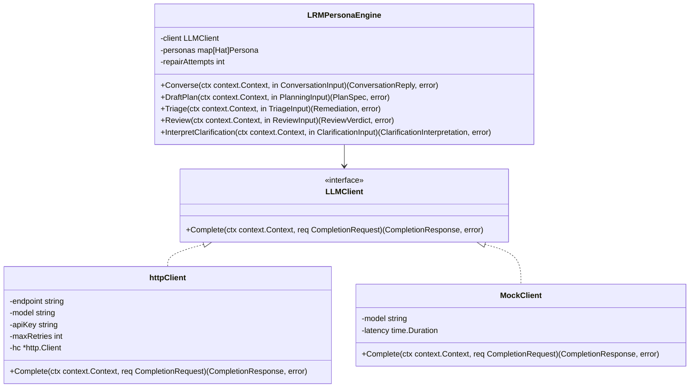

# Module Reference: `llm` (Dual-Tier Model Separation)

The `llm` package implements the dual-tier cognitive architecture of the orchestrator. It establishes a unified interface for model interactions, an HTTP client with transient retry handling, the multi-hat persona engine, and an offline deterministic simulator.

## Package Architecture



---

## 1. Unified Interface: `LLMClient`

All model invocations flow through a single, concurrent-safe interface defined in [`llm/client.go`](file:///home/jfisher/projects/GoOrchestrator/llm/client.go):

```go
type LLMClient interface {
    Complete(ctx context.Context, req CompletionRequest) (CompletionResponse, error)
}
```

### Request and Response Structure
- [`CompletionRequest`](file:///home/jfisher/projects/GoOrchestrator/llm/client.go#L34):
  - `Model`: Optional model identifier override.
  - `Messages`: Chronological message transcript (`system`, `user`, `assistant`).
  - `Temperature` & `MaxTokens`: Sampling controls.
  - `JSONMode`: Requests JSON-constrained completion.
  - `Tag`: Non-wire caller identification tag (e.g. `lrm:reviewer`, `worker:code_gen`). Used for logging and deterministic mock dispatch.
  - `Metadata`: Structured, non-wire context hints (e.g. task IDs, fields, attempt counts) consumed by mocks and observability layers.
- [`CompletionResponse`](file:///home/jfisher/projects/GoOrchestrator/llm/client.go#L60):
  - `Content`: Primary completion text or JSON payload.
  - `Usage`: Token accounting (`PromptTokens`, `CompletionTokens`, `TotalTokens`).
  - `Latency`: Duration of the call.

---

## 2. Multi-Hat Persona Engine: `LRMPersonaEngine`

The [`LRMPersonaEngine`](file:///home/jfisher/projects/GoOrchestrator/llm/lrm.go) wraps a single underlying `lrmClient`. By dynamically swapping cognitive hats (system prompts, sampling parameters, and output contracts), it allows one model to fulfill diverse reasoning responsibilities:

### Cognitive Hats & Contracts

| Hat | Persona Purpose | Primary Method | Output Type |
| :--- | :--- | :--- | :--- |
| **Conversational** | Live status answers, blocker explanation, directive detection | `Converse()` | [`ConversationReply`](file:///home/jfisher/projects/GoOrchestrator/llm/schema.go#L95) |
| **Planner** | Decomposes directives into DAG-based Epics, Stories, and Tasks | `DraftPlan()` | [`PlanSpec`](file:///home/jfisher/projects/GoOrchestrator/llm/schema.go#L44) |
| **Reviewer** | Validates worker outputs against task acceptance criteria | `Review()` | [`ReviewVerdict`](file:///home/jfisher/projects/GoOrchestrator/llm/schema.go#L64) |
| **Project Manager** | Triages repeatedly failing or ambiguous tasks | `Triage()` | [`Remediation`](file:///home/jfisher/projects/GoOrchestrator/llm/schema.go#L84) |
| **Conversational** (Op: Clarification) | Folds user answers into amended, self-contained task specs | `InterpretClarification()` | [`ClarificationInterpretation`](file:///home/jfisher/projects/GoOrchestrator/llm/schema.go#L102) |

### Self-Repair Loop
Models can occasionally emit malformed JSON or violate required schema fields. The `wear[T]()` function incorporates an automated self-repair loop:
1. Strips markdown fences and isolates top-level JSON objects using [`ExtractJSON`](file:///home/jfisher/projects/GoOrchestrator/llm/jsonutil.go#L12).
2. Unmarshals into the strongly-typed target struct and executes semantic validation.
3. If validation fails, feeds the model's output and the exact validation error back to the assistant in a correction turn (`WithRepairAttempts`, default: 2).

---

## 3. HTTP Transport Client

The [`httpClient`](file:///home/jfisher/projects/GoOrchestrator/llm/http.go) speaks the standard OpenAI-compatible `/v1/chat/completions` API protocol (compatible with vLLM, Ollama, llama.cpp, LocalAI, TGI, and cloud providers).

Features:
- Configurable timeouts and connection pooling via `*http.Client`.
- Bounded exponential-backoff retries on transient errors (network drops, HTTP 429 Too Many Requests, and HTTP 5xx server errors).
- Safety bounds on response body reading (`maxResponseBytes = 8MB`).

---

## 4. Deterministic Mock Engine: `MockClient`

The [`MockClient`](file:///home/jfisher/projects/GoOrchestrator/llm/mock.go) allows running the engine and all test suites completely offline.

It switches behavior based on `CompletionRequest.Tag` and inspects task description keywords to trigger realistic orchestration edge cases:

| Keyword in Task Description | Triggered Scenario | Engine Response |
| :--- | :--- | :--- |
| `flaky` | First worker attempt emits placeholder defect; reviewer rejects with feedback. | Second worker attempt receives feedback and produces valid code (exercises tactical retry). |
| `monolithic` | Repeated worker attempts fail review; attempts exceed `MaxRetries`. | Escalates to Project Manager; PM issues `ActionSplit`, splicing sub-tasks into DAG. |
| `ambiguous` | Reviewer issues `NeedsClarification: true`. | Escalates to PM; PM issues `ActionClarify`, pausing task in `AwaitingClarification`. |

