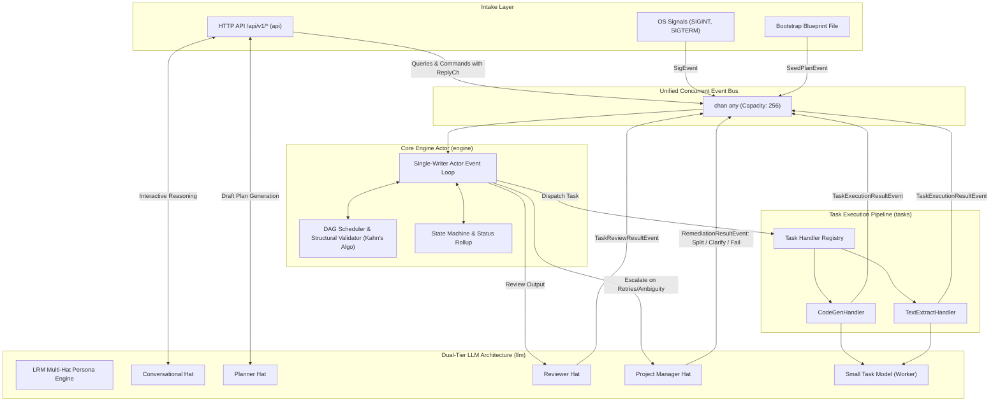

# Go Orchestrator: Event-Driven Agentic Orchestration Engine

## Architectural Overview

`GoOrchestrator` is a modular, event-driven agentic orchestration engine written in Go (Go 1.22+). It cleanly separates **high-level strategic reasoning** (delegated to a Large Reasoning Model wearing multiple cognitive "hats") from **low-level tactical execution** (delegated to small, fast worker models) over a unified, non-blocking concurrent event bus (`chan any`).

The system avoids shared-memory mutex synchronization across the orchestration core by implementing a **single-writer actor event loop**. The event loop goroutine is the sole owner of mutable plan, task, and DAG state.



---

## Core System Modules

Detailed module documentation is organized into dedicated reference guides:

| Module | Purpose | Documentation |
| :--- | :--- | :--- |
| **`agent`** | Google ADK Go v2 Conversational Liaison (`llmagent.New`) and Function Tools (`functiontool.New`) | [README](../README.md) |
| **`engine`** | Actor event loop, Kahn's algorithm DAG validation, WorkerRouter, and remediation loop | [Engine Actor & DAG Scheduler](engine.md) |
| **`tasks`** | Domain-agnostic task handler registry, code generation, text extraction, and RAG pipelines | [Task Pipeline & Handlers](tasks.md) |
| **`rag`** | Local Zen 5 embedding, cross-encoder reranking, and Qdrant vector database client | [README](../README.md) |
| **`llm`** | Transport abstractions, Reviewer/Project Manager hats, schemas, and deterministic mock | [Dual-Tier LLM Architecture](llm.md) |

---

## Key Architectural Principles

### 1. Dual-Tier Cognitive Separation
High-level strategic reasoning is decoupled from granular task execution:
- **Large Reasoning Model (LRM):** A single powerful model wearing four distinct cognitive hats ([`llm.LRMPersonaEngine`](file:///home/jfisher/projects/GoOrchestrator/llm/lrm.go)):
  1. *Conversational Hat*: Understands live system state snapshots, answers status questions, explains blockers, and classifies directives.
  2. *Planner Hat*: Converts user objectives into hierarchical plans (**Epics -> Stories -> Tasks**) forming a verifiable DAG.
  3. *Reviewer Hat*: Evaluates task outputs against objective acceptance criteria and scores quality.
  4. *Project Manager Hat*: Triages failed tasks, executing dynamic DAG re-decomposition (`split`) or pausing for targeted user input (`clarify`).
- **Small Task Model (Worker):** A fast tactical model that executes individual leaf tasks in complete isolation using only targeted local context (task specification, direct upstream outputs, and prior reviewer retry feedback).

### 2. Single-Writer Actor Model
The engine avoids data races and mutex contention:
- The actor loop in [`engine.Orchestrator`](file:///home/jfisher/projects/GoOrchestrator/engine/orchestrator.go) exclusively mutates the plan tree and DAG state.
- External callers (HTTP requests, workers, LRM reasoning routines) interact with the state machine strictly by passing event structs over `eventCh chan any`.
- Synchronous callers embed buffered reply channels (`replyCh := make(chan Result, 1)`) inside query/command events to receive state snapshots without violating ownership.

### 3. Structural DAG Soundness & Dynamic Splicing
- Every plan (bootstrap file, newly approved plan, or dynamically re-composed sub-graph) undergoes Go-side structural validation using **Kahn's algorithm**:
  - Verification that all `depends_on` IDs exist.
  - Cycle detection with exact cycle member reporting.
  - Verification that every task specifies a registered handler type.
- When a task is split by the Project Manager, sub-tasks inherit the parent task's upstream dependencies, the parent task transitions into an automated join node waiting on terminal sub-tasks, and the resulting graph is re-validated before scheduling.

### 4. Bounded Retry & Clarification Isolation
- If a leaf task fails review, the Reviewer's actionable feedback is appended to the task context and a tactical retry is triggered.
- If attempts reach `MaxRetries` (default: 3) or the Reviewer flags `NeedsClarification: true`:
  - The task escalates to the Project Manager Hat.
  - If `ActionClarify` is selected, the task transitions to `StatusAwaitingClarification`.
  - Transitive downstream dependents are marked `StatusBlocked`.
  - Independent DAG branches continue running concurrently without stalling.
  - When the user answers via `POST /api/v1/plans/{planID}/tasks/{taskID}/clarify`, the task is updated and re-queued, and downstream dependents are unblocked to `StatusPending`.

### 5. Production Operations & Clean Shutdown
- **Zero-Dependency Mock Mode:** Defaults to offline deterministic mock execution so that tests and binaries run immediately without external API keys or local LLM instances.
- **Graceful Termination:** Termination signals (`SIGINT`, `SIGTERM`) cancel the worker context, trigger the HTTP server shutdown hook, drain in-flight worker goroutines within a bounded deadline, and exit cleanly.

---

## Quickstart

### Build and Run
```bash
# Build the binary
go build -o orchestrator main.go

# Run offline with deterministic mock model and example blueprint
./orchestrator -blueprint example_blueprint.json -port 8080

# Run connected to real OpenAI-compatible model endpoints
./orchestrator -mode http -lrm-url http://localhost:8000 -worker-url http://localhost:8001 -port 8080
```

### Running Tests
```bash
# Run all unit and integration tests across the codebase
go test -v -count=1 ./...
```

